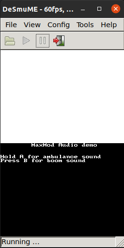

# BMDE host components installation in Linux

# 1. Objectives

The objective of this doc is to explain how to install and verify installation in the host of the **BMDE toolchain**
components. The BMDE is used in subjects:

* *Computers* (primary focus): The whole Computers subject uses all software described in this documentation.
* *Operating Systems Structure (ESO)* (secondary focus): Only the practical part of this subject needs all software
  described in this documentation.
* *Fundamentals of Computers (FC)* (tertiary focus): Only debug, build and edit.


---

# 2. Deployment Strategy and Docker Considerations

Since **Milax** is the de-facto Linux environment used by students, and the system image is managed centrally, the
recommended approach is to use bare-metal installations, instead of using the Docker based installations already built
for the BMDE CLI.

When tools are already deployed directly on an
operating system under full administrative control (as milax is), Docker does not provide significant added value.
Therefore, a
**native package-based installation** is preferred.

Docker may still be offered as an **optional alternative**, knowing Docker itself is installed on the milax image. It is
not necessary to integrate specific Docker images directly into the Milax distribution.

---

# 3. BMDE operations vs software components

A component can be understood as an independent piece of software. One or more components are used together for each
operation of the BMDE.

This guide will explain how to:
* Install each component, either the explanation of each step and the proposed commands to do it.
* Test the installation of each needed component.
* Test that each operation is working as expected.

The needed files for everything are in the repository of each component, in the `components/` folder of the
[bmde repository](https://github.com/URV-teacher/bmde) (cloned with `git clone --recursive`): its download script
(`scripts/download_assets.sh`), its install scripts (`src/`) and its tests (`test/`). All proposed commands assume that
the current directory is the root of that repository.

---

# 4. Installation considerations
Each component is installed in two stages:
1. **Download**: `scripts/download_assets.sh` of its repository downloads the files that come from outside of the
   repository (e.g. devkitARM, the sources of DeSmuME) into its `assets/` folder. If a file is already there, it only
   checks it. Every file with a fixed version is checked against its pinned SHA-256, and the script fails if it does not
   match. Run it with names of assets as arguments to download only those. All these external resources are listed in
   [external resources](../development/external-resources.md).
2. **Installation**: the scripts in the `src/` folder of its repository, which only take files from the repository
   (`src/`, `config/` and `assets/`), never from the internet.

 The same scripts install the
components in the Docker image of each component, and in the image with the full development environment
(`aleixmt/bmde-full`), so the three installations do not drift apart. The scripts are tested on Ubuntu 24.04 and 26.04
by the CI of each component.

All scripts follow the same conventions:
* Programs are installed into `/URV/bmde/PROGRAM` (e.g. `/URV/bmde/devkitPro`, `/URV/bmde/DeSmuME_0.9.11`,
  `/URV/bmde/insight`). Set the variable `BMDE_ROOT` to install them into another directory.
* The environment of each program (`PATH`, `DEVKITPRO`, `DESMUME`...) is installed into
  `/etc/profile.d/bmde-PROGRAM.sh`, which is loaded in new sessions. To load it in the current terminal, run
  `. /etc/profile.d/bmde-PROGRAM.sh` (or open a new session).
* They install their own dependencies with `apt-get`, using `sudo` when they are not run as root.
* They can be run again safely: a program that is already installed is not built again.
* They need the files downloaded by the download script, and fail asking to run it if they are missing.

Each code snippet assume that previous snippets have been run successfully.

Snippets can be executed:
* Manually, copying code line by line to a terminal
* Using the corresponding file for that snippet. The corresponding file for each snippet can be found in the source code
  of each snippet in this guide. This is because each snippet is embedded in the docs with mkdocs or with the script
  `scripts/render-guide.py`. Each script can be run with `bash components/COMPONENT/src/SCRIPT.sh` (or
  `bash components/COMPONENT/test/SCRIPT.sh` for the tests).
* Using an IDE that supports running markdown snippets or installing extensions for that purpose. In PyCharm
  you can click in the green button of each snippet to run it in the embedded terminal. We recommend unchecking
  `Close session when it ends`, in *Settings->Tools->Terminal* to see the results after running the script. Also, notice
  that there are some calls to `sudo` in the snippets, which usually stops the execution due to the command asking for
  the password. What we can do to solve this is: Execute the snippet, wait for the password prompt to appear and input
  your password. After the command with authentication has run (and the snippet execution has stopped in the middle),
  run the snippet again. Since sudo caches the recent authentications, this time the `sudo` command will not interrupt
  the snippet execution.

The tests of graphical programs (DeSmuME, Insight) open their windows for a few seconds; without a display (e.g. through
SSH) they use a virtual one, which needs `xvfb-run` (package `xvfb`).

# Operations
## Build Operation
Components:
* `make`
* devkitARM r46:
  * `arm-none-eabi-gcc`
  * `arm-none-eabi-as`
  * `arm-none-eabi-ld`
  * `ndstool` (not needed for FC subject):
* libNDS (not needed for FC subject):
* devkitPro NDS project examples (optional)

### Component installation
#### make
###### Explanation
Install `make` using your package manager.

The installed binary is expected to be automatically included in your
`$PATH` by the package manager and because of that available directly through shell commands.

###### Proposed command
```shell
--8<-- "components/devkitarm-nds-docker/src/install_make.sh"
```

###### Test component
```shell
--8<-- "components/devkitarm-nds-docker/test/test_make.sh"
```

#### devkitARM
##### Explanation
Download devkitARM from
[here](https://wii.leseratte10.de/devkitPro/devkitARM/r46%20%282017%29/devkitARM_r46-x86_64-linux.tar.bz2) and
decompress it into `/URV/bmde/devkitPro`.

Create 3 **permanent** environment variables (in `/etc/profile.d/bmde-devkitpro.sh`), which are used in the Makefiles:
* `DEVKITPRO` with value `/URV/bmde/devkitPro`.
* `DEVKITARM` with value `/URV/bmde/devkitPro/devkitARM`.
* `DESMUME` with any value if it is not defined (it just needs to be defined so that it passes the checks of the
  `Makefile`s; the installation of DeSmuME gives it its real value).

Modify **permanently** the PATH variable, **prepending** (writing at the beginning) the path `$DEVKITARM/bin` to the
variable. Including the directories in the `$PATH` make the files in the included directories directly available through
shell commands. The prepending is done to give more priority to our binaries than the system binaries.

###### Download assets
Download devkitARM r46 (and the hello world project of the course, used by the test of the operation) into
`components/devkitarm-nds-docker/assets/`.

```shell
components/devkitarm-nds-docker/scripts/download_assets.sh
```

###### Proposed command
```shell
--8<-- "components/devkitarm-nds-docker/src/install_devkitarm.sh"
```

###### Test component
```shell
--8<-- "components/devkitarm-nds-docker/test/test_devkitarm.sh"
```

#### libnds
##### Explanation
Decompress the file `libnds.tar.bz2` into `$DEVKITPRO`. The file `libnds.tar.bz2` has been obtained directly from the
original BMDE folder implementation, so in case of update of the original BMDE, it will be needed to update the provided
file.

###### Proposed command
```shell
--8<-- "components/devkitarm-nds-docker/src/install_libnds.sh"
```

###### Test component
The test builds a small program with libnds:
```shell
--8<-- "components/devkitarm-nds-docker/test/test_libnds.sh"
```

#### devkitPro NDS project examples (optional)
##### Explanation
Decompress the file `examples.tar.bz2` into `$DEVKITPRO`.

###### Proposed command
```shell
--8<-- "components/devkitarm-nds-docker/src/install_examples.sh"
```

###### Test component
The test builds some of the examples:
```shell
--8<-- "components/devkitarm-nds-docker/test/test_examples.sh"
```

### Test operation
The test builds the hello world project of the course:
```shell
--8<-- "components/devkitarm-nds-docker/test/test_operation.sh"
```

It may be possible that you need to modify a minor thing in the internal file `ds_rules`, that provides building rules
for NDS projects.

---


### Run Operation
Components:
* DeSmuME 0.9.11
* `$DESMUME/DeSmuME.exe` and `$DESMUME/DeSmuME_dev.exe` wrappers (optional, to be compatible with `Makefile`s)
* `make`, for `make run` target (`make` already explained in build section)


#### Component installation
##### desmume
###### Explanation
The distributions do not provide DeSmuME 0.9.11 (the version of the course) anymore, nor with the HUD (display of FPS,
input...) and the GDB stub that the course needs, so it is built from the sources of its Debian package into
`/URV/bmde/DeSmuME_0.9.11`. The build takes a few minutes.

Create (or modify) 1 **permanent** environment variable (in `/etc/profile.d/bmde-desmume.sh`). This is used in the
`run` and `debug` targets of the `Makefile`s:
* `DESMUME` with value `/URV/bmde/DeSmuME_0.9.11`.

It also installs `desmume-ini2gtk`, which applies the configuration of the Windows DeSmuME (`desmume.ini`: controls, HUD)
to this one. To use the controls of the course, run
`desmume-ini2gtk /URV/bmde/DeSmuME_0.9.11/share/bmde/desmume.ini`.

###### Download assets
Download the sources of DeSmuME 0.9.11 (and the ROM and project used by the tests) into
`components/desmume-docker/assets/`.

```shell
components/desmume-docker/scripts/download_assets.sh
```

###### Proposed command
```shell
--8<-- "components/desmume-docker/src/install_desmume.sh"
```

###### Test component
The test runs an NDS example for a few seconds:
```shell
--8<-- "components/desmume-docker/test/test_desmume.sh"
```
You should see something similar to this:



To test the configuration tool:
```shell
--8<-- "components/desmume-docker/test/test_config.sh"
```


##### `$DESMUME/DeSmuME.exe` and `$DESMUME/DeSmuME_dev.exe` wrappers
###### Explanation
Optionally, to make the installation of DeSmuME compatible with the `run` and `debug` targets of `Makefile`s, we need
to make available the files `$DESMUME/DeSmuME.exe` and `$DESMUME/DeSmuME_dev.exe`, because they are explicitly
referenced by the `Makefile`s.

To do so, we can create wrappers that forward the calls into `desmume`. We could implement this in another way, such a
shell alias.

###### Proposed command
```shell
--8<-- "components/desmume-docker/src/install_wrapper.sh"
```

###### Test component
```shell
--8<-- "components/desmume-docker/test/test_wrapper.sh"
```

You should see appear the window of DeSmuME.


#### Test operation
The test builds the hello world project of the course and runs it with `make run`:
```shell
--8<-- "components/desmume-docker/test/test_operation.sh"
```

You should see the DeSmuME window appearing with the hello-world message.

This test is accumulative with the build operation, because it implies it, so, if a functional `.nds` binary can be
generated from source code and executed using `desmume`, the environment can be considered operational.

---


### Debug Operation
Components:
* DeSmuME 0.9.11 with argument `--arm9gdb=$PORT` to listen to TCP port `$PORT`
* GDB debugger. Can be one of the following:
  - `insight`, the graphical debugger of the Windows BMDE (same version, built from the same source code)
  - `arm-eabi-gdb`, the GDB of the same build of Insight, in the terminal
  - `gdb-multiarch`, available through package manager
* `make`, for `make debug` target (`make` already explained in build operation section)

#### Component installation
##### DeSmuME 0.9.11 with argument `--arm9gdb=$PORT` to listen to TCP port `$PORT`
###### Explanation
Using the `desmume` command obtained in the previous section Run Operation with argument `--arm9gdb=$PORT`. We
recommend `PORT` to be higher or equal to 1024 to avoid problems, since lower ports are privileged and only root can
use them.

Unluckily the `Makefile`s have the hardcoded argument `--arm9gdb=1000` in the `make debug` target. To use this target as
a normal user, allow it to use privileged ports from 1000 with `sudo sysctl net.ipv4.ip_unprivileged_port_start=1000`.

###### Test component
```shell
--8<-- "components/desmume-docker/test/test_gdbport.sh"
```

You should see `DeSmuME listening to port 1024` in your terminal if everything was OK.

##### `insight` and `arm-eabi-gdb`
###### Explanation
Insight is the original debugger (and simulator for FC) in the BMDE. The installed version is the same one of the Windows
BMDE (GDB/Insight 7.3.50.20110803 for `arm-eabi`), built from the same source code. It also provides `arm-eabi-gdb`, the
GDB of the same build for the terminal (the `arm-none-eabi-gdb` of devkitARM r46 needs the library ncurses 5, which
current distributions do not provide anymore).

The 2011 source code needs a compiler of its time, so it is built in Ubuntu 14.04 (in the Docker image of the component,
with `build_insight.sh`) into a tarball that works in current distributions, published in the releases of
[insight-docker](https://github.com/URV-teacher/insight-docker/releases). The script installs that tarball into
`/URV/bmde/insight` (set `INSIGHT_TARBALL` to install another file).

###### Download assets
Download the tarball of Insight published in the releases of insight-docker (and the project used by the test of the
operation) into `components/insight-docker/assets/`. Without arguments, the script also reconstructs the sources of
Insight, which are only needed to build it (~900 MB download).

```shell
components/insight-docker/scripts/download_assets.sh \
  insight-7.3.50.20110803-cvs-linux-x86_64.tar.xz hello-world-nds.tar.gz
```

###### Proposed command
```shell
--8<-- "components/insight-docker/src/install_insight.sh"
```

###### Test component
```shell
--8<-- "components/insight-docker/test/test_insight.sh"
```

```shell
--8<-- "components/insight-docker/test/test_arm_gdb.sh"
```

##### `gdb-multiarch`
###### Explanation
Standard multi-architecture GDB provided via package manager.

###### Proposed command
```shell
--8<-- "components/insight-docker/src/install_gdb_multiarch.sh"
```

###### Test component
```shell
--8<-- "components/insight-docker/test/test_gdb_multiarch.sh"
```


##### `$(DEVKITPRO)/insight/bin/arm-eabi-insight` wrappers
###### Explanation
Optionally, to make the installation of Insight compatible with the `debug` target of `Makefile`s, we need to make
available the files `$(DEVKITPRO)/insight/bin/arm-eabi-insight` and `arm-eabi-insight.exe`, because they are explicitly
referenced by the `Makefile`s.

To do so, we can create wrappers that forward the calls into `arm-eabi-insight`. We could implement this in another
way, such a shell alias.

###### Proposed command
```shell
--8<-- "components/insight-docker/src/install_wrapper.sh"
```

###### Test component
```shell
--8<-- "components/insight-docker/test/test_wrapper.sh"
```


#### Test operation
The test builds the hello world project of the course, runs it in DeSmuME with the GDB stub, and debugs it with
`arm-eabi-gdb` and `gdb-multiarch`: they connect, stop at `main` and step:
```shell
--8<-- "components/insight-docker/test/test_operation.sh"
```

#### Test operation through `make debug`
To test the debug operation with Insight, run `make debug` in a project of the course (e.g. the hello world project).
Make sure that the flags `-gdwarf-3` and `-O0` are in the `CFLAGS` (arguments passed to `gcc`) of the `Makefile`. This
applies to all programs that you want to debug.

You should see both the Insight window and the DeSmuME window. To start the debug session:
1. Click the Run button of Insight. The first time, choose the target `Remote/TCP`, hostname `localhost` and port `1000`
   in the dialog.
2. Insight downloads the program into DeSmuME and stops at the first line of `main`.
3. You can change the source code mode to see different versions of the source code (ARM, mixed...).
4. Step, set breakpoints and continue with the buttons of Insight. While the program runs, DeSmuME takes the input of
   the buttons of the emulated NDS.

With `bmde debug`, Insight is already configured to connect to DeSmuME: just click the Run button.

---


### Patch Operation
Components:
* dlditool, with the DLDI patch of the course (`mpcf.dldi`)

#### Component installation
##### dlditool
###### Explanation
dlditool patches NDS ROMs with a DLDI driver, so they can access the filesystem of the CompactFlash card of the flash
cartridge used in the course. It is installed into `/URV/bmde/dlditool`, with the patch `mpcf.dldi` in its `dldi/`
folder, where dlditool finds the patches given by name.

###### Download assets
Download dlditool and the DLDI driver of the course into `components/dlditool-docker/assets/`. It also builds the ROM
used by the test (the `libfatdir` example of devkitPro) with the devkitARM installed in the build operation.

```shell
components/dlditool-docker/scripts/download_assets.sh
```

###### Proposed command
```shell
--8<-- "components/dlditool-docker/src/install_dlditool.sh"
```

###### Test component
The test patches a ROM that uses the filesystem:
```shell
--8<-- "components/dlditool-docker/test/test_dlditool.sh"
```

---


### Edit Operation
Components:
* Visual Studio Code
* arm-nds-vscode-extension

The goal is to provide an IDE to edit code and have syntax highlight for:
* ARM v5 assembly (Nintendo DS)
* C language

<!--
or
* Programmer's Notepad (WIP)


#### Component installation
##### Programmer's notepad
###### Explanation
Programmer's notepad is the original code editor used in the original BMDE. The main reason for this is the support for
ARM v5 syntax highlight (`.s` files used in the subject).

It may be not possible to install it in Linux? WIP

###### Proposed command
```shell
apt-get update && apt-get install -y --no-install-recommends desmume

echo DESMUME=/usr/games >> $HOME/.bashrc
```

###### Test component
```shell
pn
```
-->

##### Visual Studio Code
###### Explanation
Visual Studio Code is a modern IDE.

It is installed into `/URV/bmde/vscode` from the package of its website, which is also used to install its dependencies.

###### Download assets
Download the latest Visual Studio Code into `components/vscode-arm-syntax-docker/assets/`.

```shell
components/vscode-arm-syntax-docker/scripts/download_assets.sh vscode.deb
```

###### Proposed command
```shell
--8<-- "components/vscode-arm-syntax-docker/src/install_vscode.sh"
```

###### Test component
```shell
--8<-- "components/vscode-arm-syntax-docker/test/test_vscode.sh"
```

##### NDS ARM Assembly Syntax Highlight extension
###### Explanation
Extension for VSCode to enable syntax highlight for ARM v5. Available in the
[marketplace](https://marketplace.visualstudio.com/items?itemName=aleixmt.nds-arm-assembly-syntax-highlight). The
script installs the latest release of its repository for the current user, so run it without `sudo`.

###### Download assets
Download the latest release of the extension into `components/arm-syntax-vscode-extension/assets/`.

```shell
components/arm-syntax-vscode-extension/scripts/download_assets.sh
```

###### Proposed command
Once we have the command `code` available we can do the following to install the extension:
```shell
--8<-- "components/arm-syntax-vscode-extension/src/install_extension.sh"
```

#### Test operation
```shell
--8<-- "components/arm-syntax-vscode-extension/test/test_extension.sh"
```

Then, open a `.s` file of a project of the course in the IDE. You should see the syntax highlight for ARM.


---

### VCS Operation
Components:
* git
* ssh-client
* forticlient or openfortivpn

#### Component installation
##### git
###### Explanation
Install `git` and `gitk` using your package manager. Version control for course software projects. It also installs the
helpers of the BMDE to run git commands through SSH with password (`git.exp`) into `/URV/bmde/git-urv-vpn/bin`.

###### Proposed command
```shell
--8<-- "components/git-urv-vpn-docker/src/install_git.sh"
```

###### Test component
```shell
--8<-- "components/git-urv-vpn-docker/test/test_git.sh"
```

##### ssh-client
###### Explanation
SSH authentication is required for accessing the repositories.

###### Proposed command
```shell
--8<-- "components/git-urv-vpn-docker/src/install_ssh.sh"
```

###### Test component
```shell
--8<-- "components/git-urv-vpn-docker/test/test_ssh.sh"
```

##### forticlient or openfortivpn
###### Explanation
VPN access to the university network. Course Git repositories are only accessible from within the university network.
VPN access is therefore required for off-campus work. It also installs the helper of the BMDE to connect to the VPN
(`connect_vpn.sh`) into `/URV/bmde/git-urv-vpn/bin`.

###### Proposed command
For `openfortivpn`:
```shell
--8<-- "components/git-urv-vpn-docker/src/install_vpn.sh"
```

###### Test component
```shell
--8<-- "components/git-urv-vpn-docker/test/test_vpn.sh"
```

#### Test operation
When connected to the VPN (or on campus), the following command should work:

```bash
--8<-- "components/git-urv-vpn-docker/test/test_operation.sh"
```

This requires:
* The Git server to be active
* The repository `comp_25` to exist
* Proper access permissions

The Git server is maintained by the course supervisor:
**Santiago Romaní** ([santiago.romani@urv.cat](mailto:santiago.romani@urv.cat))

---

### Optional Operations
Components:
* grit

#### Component installation
##### grit
###### Explanation
Grit is a tool for converting images into GBA/NDS compatible formats. It is useful for graphics development on the NDS.
It is installed into `/URV/bmde/grit` from the devkitARM r46 release (the same binary of the devkitARM of the build
operation).

###### Download assets
Download devkitARM r46, from which grit is taken, into `components/grit-docker/assets/`. It is not needed if devkitARM
is already installed: grit is then copied from it.

```shell
components/grit-docker/scripts/download_assets.sh
```

###### Proposed command
```shell
--8<-- "components/grit-docker/src/install_grit.sh"
```

###### Test component
The test converts an image into GAS assembly, as in the course:
```shell
--8<-- "components/grit-docker/test/test_grit.sh"
```
